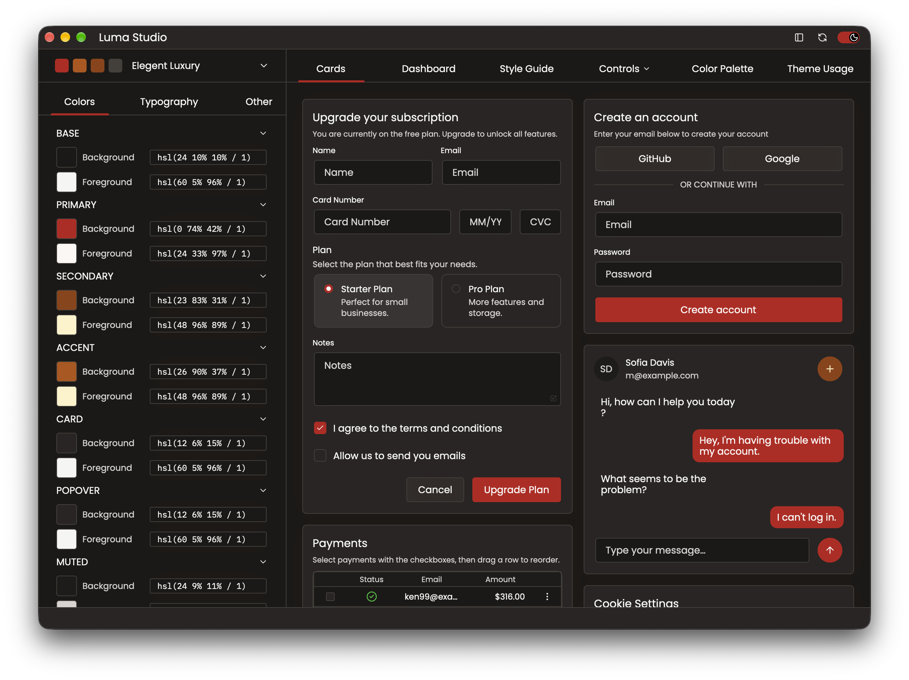
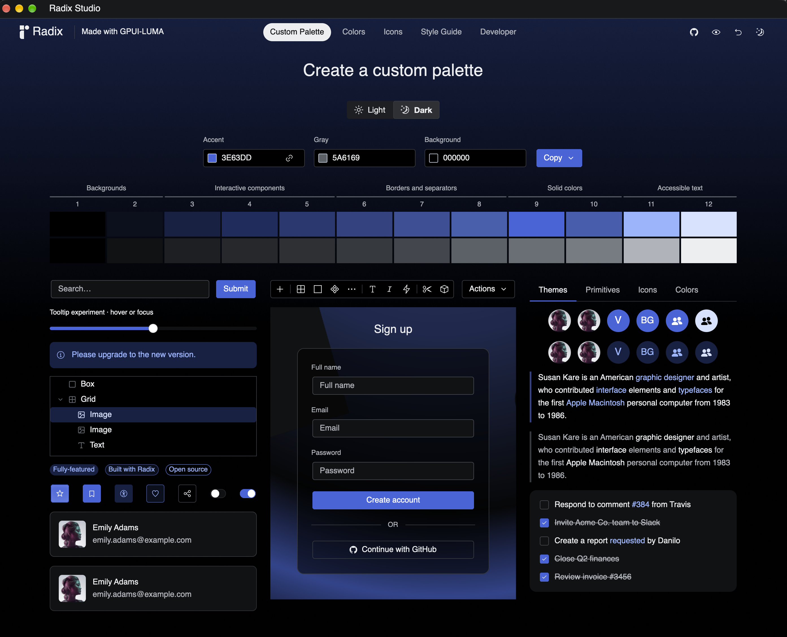
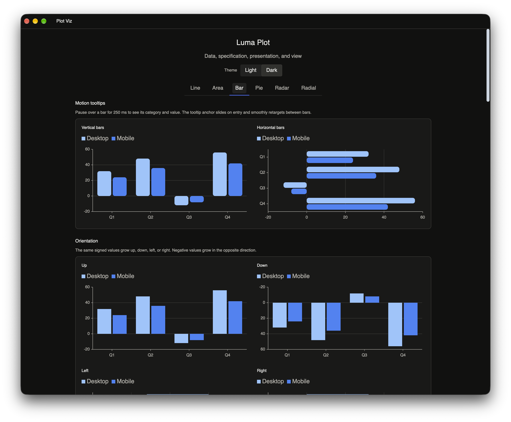

# gpui-luma

Component library built on [xgpui](https://xgpui.dev/), with a lookless
control SDK, Shadcn and Radix look adapters, color controls, and desktop example apps. Documentation is hosted at
[gpui-luma.dev](https://gpui-luma.dev). Source lives at
[gpui-luma-dev/gpui-luma](https://github.com/gpui-luma-dev/gpui-luma).

Requires a recent Rust stable toolchain (`rust-toolchain.toml` tracks `stable`).

## Build an app

Luma now uses xgpui 1.0.0 instead of gpui-unofficial. The dependency aliases
`gpui` and `gpui_platform` keep existing Rust imports unchanged. Browser builds
use `xgpui-web`, aliased as `gpui_web`.

Use the published crates directly; a GitHub checkout is only needed to run the
repository’s example apps or contribute to the libraries.

```bash
cargo new my-luma-app
cd my-luma-app
cargo add gpui-luma@0.2 gpui-luma-look-shadcn@0.2
cargo add xgpui@=1.0.0 --rename gpui
cargo add xgpui-platform@=1.0.0 --rename gpui_platform --features font-kit
```

Add the [complete app example](https://gpui-luma.dev/#sample) to `src/main.rs`, then
run `cargo build` or `cargo run`. Choose the Radix look instead of Shadcn, or use
the SDK’s built-in styling. Add color controls and plots as needed.

Use `0.2` for Luma dependencies to accept compatible `0.2.x` releases. Run
`cargo update` to refresh versions already recorded in `Cargo.lock`.

```toml
[dependencies]
gpui = { package = "xgpui", version = "=1.0.0" }
gpui_platform = { package = "xgpui-platform", version = "=1.0.0", features = ["font-kit"] }
gpui-luma = "0.2"
gpui-luma-look-shadcn = "0.2"
# Alternatively: gpui-luma-look-radix = "0.2"
# Optional: gpui-luma-color = "0.2"
# Optional: gpui-luma-plot = "0.2"
```

## Library crates

| Crate | Purpose |
|---|---|
| [`gpui-luma`](https://crates.io/crates/gpui-luma) | Lookless controls, layouts, focus, interaction, motion, and shared theme contracts |
| [`gpui-luma-look-shadcn`](https://crates.io/crates/gpui-luma-look-shadcn) | Shadcn themes, CSS tokens, styled builders, and optional inspection tooling |
| [`gpui-luma-look-radix`](https://crates.io/crates/gpui-luma-look-radix) | Radix themes, palette scales, custom colors, and styled builders |
| [`gpui-luma-color`](https://crates.io/crates/gpui-luma-color) | Color fields, rings, sliders, swatches, and color rendering primitives |
| [`gpui-luma-plot`](https://crates.io/crates/gpui-luma-plot) | Cartesian, pie, radar, and radial charts |

Depend on **`gpui-luma`**, then choose a look adapter. Add `gpui-luma-color` for
color controls. All five library crates are available on crates.io.

Import the SDK with `use gpui_luma::…`. Look adapter imports use
`gpui_luma_look_shadcn` or `gpui_luma_look_radix`.

## Styling

Use the SDK’s built-in light/dark styling, or choose the
[Shadcn](https://gpui-luma.dev/look-shadcn.html) or
[Radix](https://gpui-luma.dev/look-radix.html) Look. See the
[web docs](https://gpui-luma.dev/looks.html) for theme configuration.

## Example programs

Clone the repository to run its desktop examples:

```bash
git clone https://github.com/gpui-luma-dev/gpui-luma.git
cd gpui-luma
```

**Use release builds for optimal app performance. Debug builds are intended for
development and can make rendering and interactions noticeably slower.**

The [justfile](justfile) runs apps and explicit builds in release mode by default.
Use `just --set profile dev <recipe>` for a development build. Run `just` to list
recipes without launching an app. Without `just`, run the corresponding
`cargo run -p <package> --release` command.

**Luma Studio** — Shadcn look workbench (control docs, theme inspection):



```bash
just app-studio
# Debug: just --set profile dev app-studio
```

**Luma Radix Studio** — Radix style guide, custom palette editor, and control previews:



```bash
just app-radix
# Debug: just --set profile dev app-radix
```

**Luma Plot Viz** — chart galleries using `gpui-luma-plot` and the SDK’s built-in styling, with line, area, bar, pie, radar, and radial examples:



```bash
just app-plot
# Debug: just --set profile dev app-plot
```

Additional examples (also release builds by default):

```bash
just app-neumorphic
just shell-detached
just shell-split-titlebar
just shell-vscode
just shell-2026
```

For profiling, use `just perf-studio` to enable the Metal HUD, or
`just --set profile dev app-studio-backtrace` to run a debug build with Rust backtraces.

The shell demos accept `default` or a built-in Shadcn theme ID,
such as `retro-arcade`, as their first argument. Recipes forward arguments to the
app and use the default theme when none is provided:

```bash
just shell-vscode retro-arcade
```

## Prebuilt executables

The [Build Luma Studio](https://github.com/gpui-luma-dev/gpui-luma/actions/workflows/build.yml)
workflow runs **manually only** using GitHub Actions' **Run workflow** button.
It builds `luma-studio` for macOS Apple Silicon, Windows x64, and Windows ARM64.
Download the executable ZIPs from a successful run's **Artifacts** section;
artifacts are retained for seven days.

## Development checks

From the repository root, use the library checks during development:

```bash
just sdk-check
just sdk-build
just sdk-test
just sdk-clippy
just sdk-doc-test
```

Check, build, and Clippy target Cargo’s five default library members. The test
recipes use CI’s selected library suites; `sdk-test` also includes `luma-app-common`.
For the full workspace, use `just workspace-check`, `just workspace-build`, or
`just workspace-test`. Run `just apps-build` to compile all native apps without
launching them. `just ci` runs formatting, Python helper tests, workspace Clippy,
selected library tests and doc-tests, and control documentation checks. Run
`just fmt` to format the workspace.
Before sending a PR, run:

```bash
just pre-pr
```

This runs formatting, workflow lint, native and WASM Clippy, library tests and
doc-tests, documentation example compilation, Python helper/packaging tests,
JavaScript syntax checks, and whitespace checks. It checks all app targets with
Clippy but does not run sample app tests, launch apps, or build deployment assets.
It stops at the first failure.

Requires Node.js and [actionlint](https://github.com/rhysd/actionlint) on `PATH`,
plus the WASM Rust target (`rustup target add wasm32-unknown-unknown`). On macOS,
install the tools with `brew install node actionlint`. Native-only Rust linker
flags are cleared for the WASM check.

The `test-support` features enable headless GPUI interaction tests.

## License

Apache-2.0. See [LICENSE](LICENSE). Bundled third-party material retains its own
license terms; attribution files are included with the relevant crates and assets.
